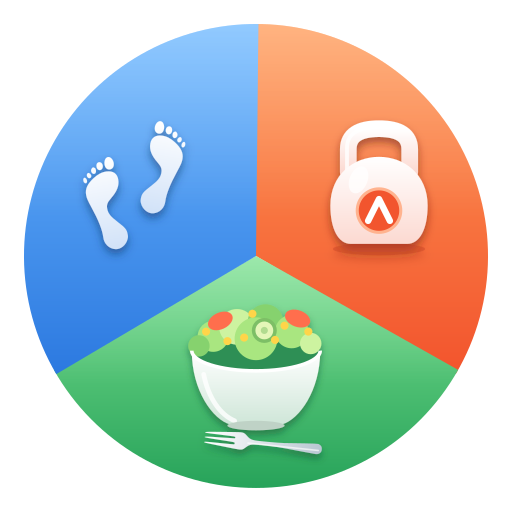
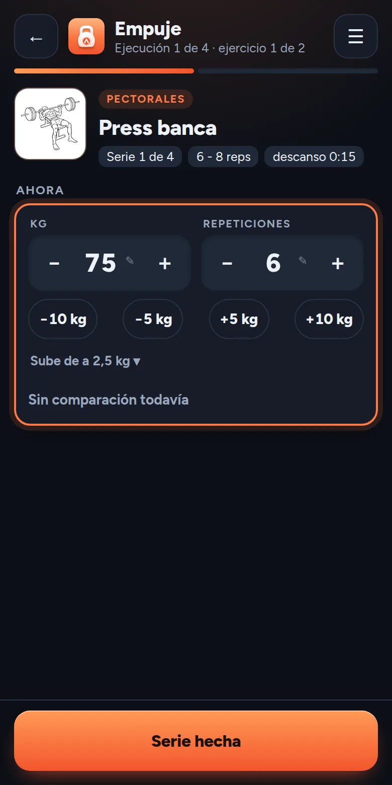
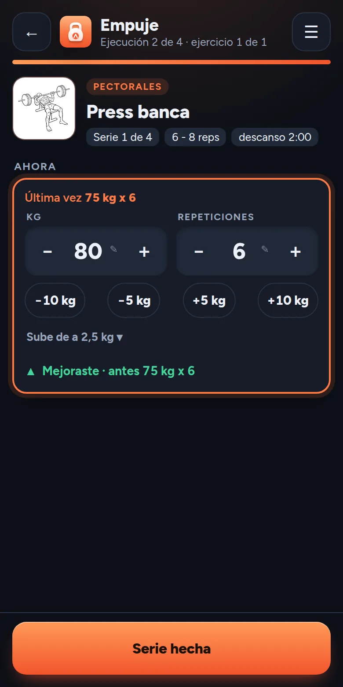
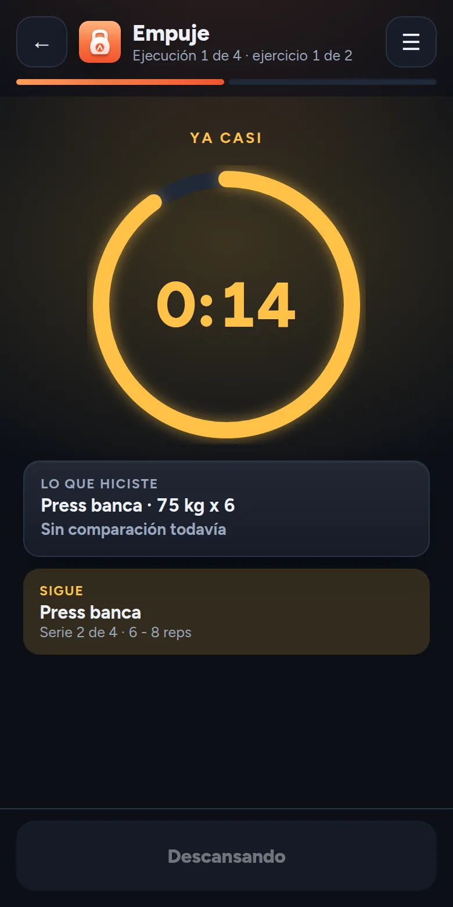

<p align="center">
  
</p>

<h1 align="center">MejorAndo</h1>

<p align="center">
  <strong>Tu rutina, sin papel y sin vueltas.</strong><br>
  Planificá tus entrenamientos de fuerza, seguilos serie por serie y mirá si mejoraste.<br>
  Gratis, sin cuenta y sin conexión.
</p>

<p align="center">
  <a href="https://mdev-repos.github.io/mejorando/"><strong>Abrir la app</strong></a> ·
  <a href="https://mdev-repos.github.io/mejorando-landing/">Sitio</a> ·
  <a href="https://mdev-repos.github.io/mejorando-landing/faq.html">Preguntas frecuentes</a> ·
  <a href="docs/README.md">Documentación</a>
</p>

<p align="center">
  
  
  
</p>

---

## Por qué existe

Bajé 20 kg en unos meses, estudiando mucho sobre entrenamiento y salud por mi cuenta. Durante ese tiempo lo llevé todo a mano, el progreso en el gimnasio con papel y bolígrafo y la dieta en hojas de cálculo. Esa forma de anotar fue lo que más me ayudó a mejorar mi manera de trabajar.

Quise construir una app que recogiera aquello que hice en papel, para que otras personas también puedan conseguir sus objetivos. Es una app chica y hace pocas cosas. Las que hace tienen que servir entre una serie y otra, siendo una ayuda y no una molestia.

## Qué hace

- **Un plan en cuatro niveles.** Un macrociclo agrupa mesociclos, cada mesociclo es una rutina con sus días, y cada día se hace varias veces, que son las ejecuciones. Una rutina avanzada suma JumpSet, rest pause y escalonado.
- **Cada serie, contra la anterior.** Al terminar una serie te dice si mejoraste. Las series de aproximación se guardan aparte.
- **Descansos que se respetan.** El descanso lo define la rutina. Cambia de color cuando se acerca el final y avisa con sonido y vibración.
- **253 ejercicios,** casi todos con dibujo, y los que quieras crear.
- **Pasá tu rutina a otra persona** por el menú de compartir o como texto para pegar en un chat, sin tu historial.
- **Tus datos son tuyos.** Viven en tu teléfono, con una copia de seguridad y un recordatorio para hacerla.
- **Funciona sin conexión** y se instala como una app. Cuando hay una versión nueva, te avisa.

## Instalarla

- **Android.** Abrí la app con Chrome y tocá **Instalar** en la tarjeta de Inicio, o el menú de los tres puntos y **Instalar aplicación**.
- **iPhone.** Abrila con Safari, tocá **Compartir** y después **Agregar a inicio**. Todavía no se probó en iPhone y no vibra.

## Estado

Está en **beta** (versión 0.2). Puede tener errores y algunas cosas van a cambiar. Hay más detalle en las [preguntas frecuentes](https://mdev-repos.github.io/mejorando-landing/faq.html). Si encontrás un error o tenés una idea, dejala en el [formulario de comentarios](https://forms.gle/BD4rLPc3CnRy8jAa6).

Lo que viene, en este orden, es comparar ejecuciones y ver el progreso, y después los módulos AlimentAndo (calorías, peso y medidas) y CaminAndo (pasos). Está en la [hoja de ruta](docs/04-hoja-de-ruta.md).

## Cómo está hecha

MejorAndo es un proyecto personal con tres propósitos. Tener una app útil, practicar el desarrollo de una aplicación de punta a punta, y practicar el desarrollo asistido con IA. La construí junto con Claude, el asistente de Anthropic. Yo decido qué se hace y por qué, Claude escribe buena parte del código del frente, y cada decisión importante queda escrita.

| Pieza | Tecnología |
|---|---|
| Interfaz | React, TypeScript y Vite |
| Datos | IndexedDB con Dexie, con migraciones entre versiones |
| Instalación y sin conexión | PWA con service worker y aviso de versión nueva |
| Pruebas | Vitest y Testing Library, con 74 pruebas |
| Calidad | ESLint, Prettier, tipos estrictos e integración continua en GitHub Actions |

Las reglas del entrenamiento viven separadas de las pantallas, como funciones puras que se prueban sin abrir un navegador. Está todo explicado en la [documentación](docs/README.md), con las [decisiones de diseño](docs/decisiones/README.md) y la [historia del proyecto](docs/historia.md).

## Correrla en tu computadora

Hace falta Node 22.

```bash
cd web
npm install
npm run dev
```

Otros comandos útiles son `npm test`, `npm run lint`, `npm run typecheck` y `npm run build`. Al correr `npm run dev` aparecen herramientas de desarrollo, como el modo de prueba de los descansos. La versión publicada no las trae ([ADR-017](docs/decisiones/ADR-017-herramientas-de-desarrollo.md)).

## Estructura

| Carpeta | Contenido |
|---|---|
| `web` | La aplicación (React, TypeScript, Vite) |
| `docs` | La documentación de diseño, las decisiones y los archivos de marca |

## Salud

MejorAndo es una herramienta de registro y no reemplaza a un profesional de la salud. Antes de empezar un plan de entrenamiento o de alimentación, consultá con tu médico. Para entrenar, con un deportólogo, y para comer, con un nutricionista. Como referencia, para entrenar el canal de [Roberto Amorosi y la Escuela de Culturismo Natural](https://www.youtube.com/@EscuelaCulturismoNatural) y su [academia](https://www.escuelaculturismonatural.com/), y para comer el canal de [Francis Holway](https://www.youtube.com/@fholway), nutricionista argentino, y las entrevistas que le hicieron en otros canales. La app no incluye material de ninguno de ellos.

## Licencia y créditos

- **Código.** [GPL 3.0 o posterior](LICENSE). Podés usarlo, estudiarlo y modificarlo, y si publicás una versión modificada tenés que compartirla con la misma licencia.
- **Documentación.** [CC BY-SA 4.0](https://creativecommons.org/licenses/by-sa/4.0/).
- **Dibujos de los ejercicios.** Son del proyecto [Everkinetic](https://github.com/everkinetic/data), de Greg Priday, con licencia CC BY-SA 4.0. Se convirtieron a WebP y se redimensionaron, sin cambiar el dibujo.
- **Nombre y logo.** El nombre MejorAndo y su logo no están cubiertos por la licencia del código. Se pueden mencionar y enlazar, pero una versión derivada no puede presentarse con ellos.
- **Tipografía.** Figtree, con licencia OFL.

Hecho por [Matías Mazzitelli](https://github.com/mdev-repos).
