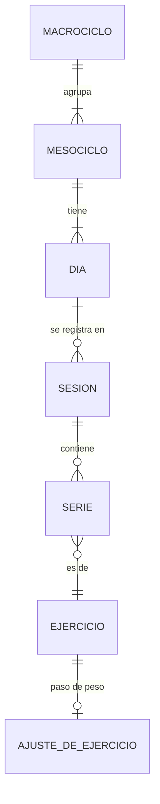

# 02 Dominio

Este documento fija el vocabulario del entrenamiento de fuerza y las reglas que la aplicación aplica. Describe lo que está construido. Las ideas que todavía no existen están en [05 Posibles mejoras](05-posibles-mejoras.md).

## Glosario

| Término | Significado |
|---|---|
| Macrociclo | Un período largo que agrupa mesociclos, por ejemplo "Principiante". |
| Mesociclo | Una rutina con sus días, por ejemplo "PPL". Es simple o avanzada y tiene una cantidad de ejecuciones. |
| Día | Un entrenamiento tipo dentro del mesociclo, por ejemplo "Empuje", con sus ejercicios. |
| Ejecución | Cada vez que se hace un día. Si Empuje se ejecuta 4 veces, hay Empuje 1, 2, 3 y 4. |
| Ejercicio | Un movimiento del catálogo, por ejemplo "Press banca", o uno propio. |
| Serie efectiva | Una serie de trabajo. Es la que se anota y la que cuenta para medir el progreso. |
| Serie de aproximación | Una serie liviana previa, para entrar en calor. Se guarda con la etiqueta "Aprox" y no cuenta para el progreso. |
| JumpSet | Dos o tres ejercicios que se hacen por rondas, con un descanso propio después de cada uno. |
| Rest pause | Un tramo extra de repeticiones con el mismo peso, después de un descanso breve, en la última serie. |
| Escalonado | Un generador de series con repeticiones decrecientes, por ejemplo 10, 8, 6 y 4. |

## Plan y registro

La aplicación maneja dos cosas que conviene no mezclar.

- **El plan** dice qué hay que hacer. Se arma antes de entrenar.
- **El registro** dice qué se hizo. Se crea cada vez que se entrena.

Al empezar una sesión, el plan se copia dentro de ella. Así editar la rutina después no cambia lo que ya se hizo, y se puede repetir un mesociclo o compararlo con el anterior.

## Los cuatro niveles

| Nivel | Ejemplo |
|---|---|
| Macrociclo | "Principiante" |
| Mesociclo | "PPL", con 3 días |
| Día | Empuje, Tirón y Piernas |
| Ejecución | Empuje 1, Empuje 2, Empuje 3 y Empuje 4 |

La cantidad de ejecuciones es una sola para todo el mesociclo. Si hay tres días, cada uno se hace la misma cantidad de veces, para medir el progreso de manera pareja. Cada día muestra sus ejecuciones, las hechas y las que faltan. Solo hay una sesión activa a la vez.

## Rutina simple y avanzada

Al crear un mesociclo se elige entre dos modos, para no sobrecargar de opciones a quien recién empieza.

- **Simple.** Ejercicios con series, repeticiones y descanso. Todas las ejecuciones de un día son iguales.
- **Avanzada.** Suma los protocolos y deja que cada ejecución sea distinta. La ejecución 1 es la base y las demás la siguen hasta que se las personaliza.

Se puede pasar de simple a avanzada sin perder lo cargado.

## Qué se pide por serie

| Tipo | Ejemplo | Cómo se interpreta |
|---|---|---|
| Fija | `8` | Todas las series apuntan a 8 repeticiones |
| Rango | `8 - 10` | Se apunta a quedar dentro del rango |
| Secuencia | `10 \| 8 \| 6 \| 4` | Una cantidad por serie, como en un escalonado |
| Fallo | al fallo | Se llega al fallo, sin repeticiones fijas |

Un ejercicio puede ser de peso externo, de peso corporal (sin casillero de kilos) o de tiempo, donde las repeticiones son segundos.

## Armar una rutina

La rutina se arma eligiendo, no escribiendo. Se agrega un ejercicio, se elige un grupo muscular, se elige un ejercicio de la lista y se completan series, repeticiones y descanso. En una rutina avanzada se elige además si el ejercicio es normal o lleva un protocolo.

- **JumpSet.** Se eligen dos o tres ejercicios, la cantidad de rondas y el descanso que sigue a cada uno.
- **Rest pause.** Va siempre en la última serie y una sola vez, con 20 segundos de descanso por defecto. Con 80 kg en press banca, por ejemplo, la serie 1 es de 8 repeticiones, la serie 2 de 6, la serie 3 de 4, y 20 segundos después vienen 2 repeticiones más. El tramo principal se compara como cualquier serie, y las repeticiones extra se comparan aparte.
- **Escalonado.** Se elige la cantidad de series, las repeticiones de la primera y el salto entre series, que por defecto es de menos 2. Con 4 series de 10 se arma 10, 8, 6 y 4.

## Series de aproximación

Al empezar un grupo muscular, la aplicación pregunta una sola vez si se van a hacer series de aproximación. Es por grupo y no por ejercicio, porque los ejercicios siguientes del mismo músculo ya encuentran el cuerpo en calor. Si la respuesta es sí, se completan filas de peso y repeticiones y después se pasa a las series efectivas.

Las series de aproximación no se comparan con la vez anterior ni cuentan para el progreso. Se distinguen con un color más claro y la etiqueta Aprox.

## Descansos fijos

El descanso entre series lo define la rutina, ejercicio por ejercicio, con valores de 0:45, 1:00, 1:30, 2:00, 2:30 y 3:00, o uno propio. En un JumpSet los valores van de 0:15 a 1:30. Durante la sesión se respeta tal cual, sin botones para acortarlo ni alargarlo. El botón dice "Descansando" hasta que el tiempo termina ([ADR-010](decisiones/ADR-010-cuatro-niveles-y-descansos-fijos.md)).

El descanso avisa de tres maneras que se suman ([ADR-011](decisiones/ADR-011-avisos-del-descanso-y-control-numerico.md)).

| Momento | Color y texto |
|---|---|
| Normal | Naranja |
| A los 15 segundos | Amarillo, "Ya casi" |
| A los 10 segundos | Rojo, "Preparate" |
| Al llegar a cero | Verde, "Listo" |

Además suena un tic en los últimos tres segundos y un aviso al terminar, y en los teléfonos que lo permiten, vibra. Sonido y vibración se apagan por separado en Ajustes.

## Peso sugerido

La aplicación recuerda con cuánto peso se hizo cada ejercicio la última vez y lo propone como punto de partida. Cada ejercicio tiene su propio paso de peso, de 1, 2, 2,5, 5 o 10 kg, que por defecto depende del equipo, 2,5 para barra, 2 para mancuernas, 5 para máquinas y poleas, y 1 para peso corporal.

## Comparación con la vez anterior

Cada serie efectiva se compara con la misma serie, con el mismo número, del mismo ejercicio en la sesión anterior. El resultado se muestra en la sesión con símbolo y texto, nunca solo con color.

- **Mejoró** si el peso es mayor que el de la vez anterior, aunque las repeticiones sean menos. También si el peso es igual y las repeticiones son más.
- **Igualó** si el peso y las repeticiones son los mismos.
- **Por debajo** si el peso es menor, o si el peso es igual y las repeticiones son menos.

Si más adelante esta regla resulta injusta en algún caso, por ejemplo con mucho más peso para muy pocas repeticiones, se puede revisar.

## Corregir lo hecho

Una sesión terminada se puede revisar. Cada serie se puede corregir (peso y repeticiones) o borrar, y se puede borrar el entrenamiento entero. Al borrar una sesión se recalculan las ejecuciones hechas del día.

## Catálogo de ejercicios

El catálogo trae 253 ejercicios. Cada uno guarda su nombre, el grupo muscular, el equipo y el tipo de carga. Los grupos son pectorales, espalda, hombros, bíceps, tríceps, cuádriceps, isquiotibiales, glúteos, pantorrillas y abdominales. Casi todos tienen una ilustración ([ADR-012](decisiones/ADR-012-ilustraciones-de-ejercicios.md)). Cada persona puede agregar ejercicios propios.

## Compartir una rutina

Un macrociclo entero o un mesociclo se pasa a otra persona como un archivo o como texto para pegar en un chat ([ADR-013](decisiones/ADR-013-compartir-rutinas-e-instalacion.md)). Lleva los mesociclos, los días y los ejercicios propios que usa. No lleva sesiones ni series. Quien lo recibe lo carga y queda como un macrociclo nuevo, sin tocar lo que ya tenía.

## Modelo de datos

Los datos viven en el teléfono, en una base local (IndexedDB, con Dexie). No hay servidor ni usuarios.

| Entidad | Qué guarda |
|---|---|
| Macrociclo | Nombre |
| Mesociclo | Nombre, orden, modo (simple o avanzado) y cantidad de ejecuciones |
| Día | Nombre, orden, los ejercicios de la ejecución 1 y, en una rutina avanzada, los de las que difieren |
| Ejercicio | Nombre, grupo, equipo y tipo de carga. Los propios llevan un identificador único |
| Ajuste de ejercicio | El paso de peso elegido para ese ejercicio |
| Sesión | El día, la ejecución, una copia del plan, el estado, y el punto en que va el descanso |
| Serie | Peso y repeticiones, si es efectiva o de aproximación, su número y, si hubo rest pause, las repeticiones extra |

Detalles que se mantienen a lo largo del modelo.

- Todos los registros llevan un identificador generado en el dispositivo, así se crean sin conexión y se pueden pasar a otra persona sin chocar.
- Los planes se marcan como borrados sin perderse del todo. Las sesiones y las series se borran de verdad cuando se las corrige.
- Los datos tienen versión. Cuando cambia la forma de guardarlos, la app migra lo que ya está en el teléfono ([ADR-010](decisiones/ADR-010-cuatro-niveles-y-descansos-fijos.md)).

## Formatos de archivo

| Formato | Para qué | Qué lleva |
|---|---|---|
| `mejorando`, versión 3 | La copia de seguridad | Todo, incluyendo el historial. También lee las copias de versiones anteriores |
| `mejorando-rutina`, versión 1 | Pasar una rutina | Mesociclos, días y ejercicios propios, sin historial |
