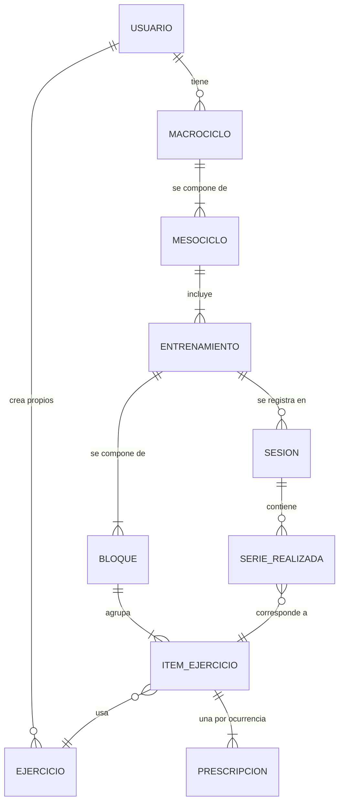

# 02 Dominio

Este documento fija el vocabulario del entrenamiento de fuerza y el modelo de datos que la aplicación maneja. Es la base para las pantallas, la base de datos y la API.

## Glosario

| Término | Significado |
|---|---|
| Macrociclo | Un período largo con un objetivo claro (fuerza, volumen o técnica) y una duración fija. Agrupa varios mesociclos que se hacen uno detrás del otro. |
| Mesociclo | Una rutina completa dentro de un macrociclo, con su propia distribución de entrenamientos. |
| Split | La forma de repartir los músculos entre los días, por ejemplo PPL, Upper/Lower o Full Body. |
| Entrenamiento | Un día tipo dentro del mesociclo, por ejemplo "A, Upper". Un mesociclo tiene dos o tres entrenamientos distintos. |
| Ocurrencia | Cada vez que se hace un mismo entrenamiento. Un entrenamiento se repite tres, cuatro o cinco veces, y eso define cuánto dura el mesociclo. |
| Ejercicio | Un movimiento del catálogo, por ejemplo "Press banca". |
| Serie efectiva | Una serie de trabajo, la que se anota y la que cuenta para medir el progreso. |
| Serie de aproximación | Una serie liviana previa, para entrar en calor antes de las series efectivas de un grupo muscular. Se guarda marcada como aproximación y no cuenta para medir el progreso. |
| RIR | Repeticiones en reserva, qué tan cerca del fallo se termina la serie. RIR 0 es llegar al fallo. |
| nRM | El peso con el que se pueden hacer como máximo n repeticiones. 8RM es la carga con la que se logran 8 repeticiones y no más. |
| Técnica | Una forma especial de hacer la serie, como el rest pause. |
| JumpSet | Dos o tres ejercicios que se hacen por rondas. Se hace la serie del primer ejercicio, se descansa lo que indica, se hace la serie del siguiente, se descansa lo que indica, y así hasta terminar todas las series de todos los ejercicios. |
| Descarga activa | Una ocurrencia con menos series, para recuperar. |
| Test Day | Una ocurrencia especial donde se mide la fuerza, por ejemplo una única repetición pesada. |

## La idea central, plan y registro

La aplicación maneja dos cosas distintas que conviene no mezclar.

- **El plan** dice qué hay que hacer. Se arma una vez, antes de entrenar.
- **El registro** dice qué se hizo. Se crea cada vez que se entrena.

La app compara el registro con el plan (qué toca hoy) y con registros anteriores (qué hice la vez pasada). Si estas dos cosas estuvieran mezcladas en una sola, no se podría ni repetir un mesociclo ni compararlo con el anterior.

## El plan es una matriz

En la planilla de papel que se reemplaza, el plan no es "un ejercicio con tantas series y repeticiones". Es una tabla donde cada fila es un ejercicio y cada columna es una ocurrencia del entrenamiento, y lo que se pide cambia de una columna a otra.

Por ejemplo, un ejercicio puede pedir tres series de 8 | 6 | 4 la primera vez, tres series de 8 la cuarta, y dos series en la descarga activa. La progresión del ciclo vive en el plan, y por eso el modelo guarda una **prescripción por cada combinación de ejercicio y ocurrencia**.

## Tipos de objetivo de repeticiones

| Tipo | Ejemplo | Cómo se interpreta |
|---|---|---|
| Fija | `8` | Todas las series apuntan a 8 repeticiones |
| Rango | `5 - 10` | Se apunta a quedar dentro del rango |
| Secuencia por serie | `8 \| 6 \| 4` | La primera serie a 8, la segunda a 6 y la tercera a 4 |
| Tiempo | `45"` | Se sostiene durante 45 segundos |
| Solo cercanía al fallo | `(RIR 0)` | Se llega al fallo, sin repeticiones fijas |
| Repeticiones a una carga de nRM | `3 @ 8RM` | Tres repeticiones con la carga con la que se harían 8 como máximo |
| Compuesta | `12 + 12` | Dos movimientos seguidos en la misma serie |

Además, un ejercicio puede ser de peso externo, de peso corporal (sin casillero de kilos) o de tiempo.

## JumpSets

Un JumpSet es un bloque de dos o tres ejercicios que se hacen por rondas. En cada ronda se hace una serie del primer ejercicio, se descansa el tiempo que indica ese ejercicio, se hace una serie del siguiente, se descansa lo que indica ese otro, y así hasta cerrar la ronda. Después viene la ronda siguiente, y el bloque termina cuando se completaron todas las series de todos los ejercicios.

Cada ejercicio del bloque tiene su propia prescripción y su propio tiempo de descanso, que suele ser más corto que en un ejercicio suelto. La vista de entrenamiento guía el orden y los descansos entre cada paso.

## Armar una rutina desde el catálogo

La rutina no se escribe a mano, se arma eligiendo. Se toca agregar, se elige un grupo muscular, se elige un ejercicio de la lista de ese grupo y queda cargado, con unos pocos toques. Por ejemplo, agregar, pectorales, press banca.

Al agregar un ejercicio se elige cómo se va a trabajar.

- **Normal.** El ejercicio lleva series y repeticiones, como en una rutina común. Se elige la cantidad de series y el objetivo de repeticiones (fijo, rango, secuencia y los demás tipos de la tabla de arriba).
- **Protocolo.** El ejercicio se trabaja de una forma fuera de lo común. Hoy están pensados el JumpSet, que alterna más de un ejercicio, y el rest pause, y la lista se puede ampliar. Al elegir un protocolo, la aplicación pide solo lo que ese protocolo necesita.

Los protocolos son una idea a mejorar entre los dos, y esto es solo el punto de partida.

- **JumpSet.** Se eligen dos o tres ejercicios del catálogo, y se indica cuántas rondas se hacen y cuánto se descansa después de cada ejercicio.
- **Rest pause.** Trabaja sobre la fatiga del fallo muscular. Las series comunes llevan su descanso, por ejemplo dos minutos. En la última serie, después de llegar al fallo, se descansa unos 20 segundos y se vuelve a levantar el mismo peso hasta el fallo. Con 80 kg en press banca, por ejemplo, la serie 1 es de 8 repeticiones, la serie 2 de 6, la serie 3 de 4, y 20 segundos después vienen 2 repeticiones más. En el registro, esa última serie lleva un tramo principal y un tramo de rest pause. El rest pause va siempre en la última serie y se hace una sola vez, para trabajar sobre la fatiga acumulada y entrenar más allá del fallo muscular. Como propuesta a confirmar, el tramo principal se compara con la vez anterior como cualquier serie, y las repeticiones del rest pause se muestran aparte, con su propia comparación.

El **escalonado** es un generador de series. Se elige la cantidad de series, las repeticiones de la primera y el salto entre una serie y la siguiente, que por defecto es de menos 2. Con 4 series de 10 repeticiones se arma 10, 8, 6 y 4. El salto también puede ser positivo.

La carga desde una planilla queda como una etapa posterior, después de que el armado por catálogo funcione.

## Cómo se organiza en la aplicación

La planificación tiene cuatro niveles, que la aplicación tiene que mostrar y dejar armar. Un ejemplo.

| Nivel | Ejemplo |
|---|---|
| Macrociclo | "Principiante", con 4 mesociclos |
| Mesociclo | "PPL", con 3 días |
| Entrenamiento (día) | Push, Pull y Legs, uno por día |
| Ejecución | Cada vez que se hace un día. Si Push se ejecuta 4 veces, hay Push 1, Push 2, Push 3 y Push 4 |

La cantidad de ejecuciones es una sola para todo el mesociclo. Si hay tres días, A, B y C, cada uno se hace la misma cantidad de veces, sea 3, 4 o 6, para poder medir el progreso de manera pareja.

La pantalla de planificación baja por esos niveles. Se elige un macrociclo, se ve la lista de sus mesociclos, se elige un mesociclo para ver sus días, y cada día muestra sus ejecuciones, las hechas y las que faltan.

## Rutina simple y rutina avanzada

Al crear una rutina se elige entre simple y avanzada, para no sobrecargar de opciones a quien recién empieza.

- **Simple.** Ejercicios con series y repeticiones, y el descanso de cada uno. Todas las ejecuciones de un día son iguales.
- **Avanzada.** Suma los protocolos (JumpSet, rest pause, escalonado) y permite que cada ejecución de un mismo día sea distinta, con otras series, repeticiones o protocolos. Al elegirla se pregunta cuántas ejecuciones va a tener.

Una rutina simple se puede pasar a avanzada más adelante, sin perder lo cargado.

## Descansos fijos

El descanso entre series lo define la rutina, ejercicio por ejercicio (45 segundos, 1 minuto, 1:30, 2 minutos, 2:30 y así). Durante la sesión se respeta tal cual, sin botones para acortarlo ni alargarlo. Para probar la aplicación hay un modo de prueba en los ajustes, apagado por defecto, que permite adelantar el descanso.

El descanso avisa de tres maneras que se suman. El color y el texto cambian a los 15 segundos (amarillo, "ya casi"), a los 10 (rojo, "preparate") y al llegar a cero (verde, "listo"). Suena un tic en los últimos tres segundos y un aviso al terminar. Y en los teléfonos que lo permiten, vibra. Sonido y vibración se apagan por separado en los ajustes.

## Peso sugerido

La aplicación recuerda con cuánto peso se hizo cada ejercicio la última vez y lo propone como punto de partida. El peso de arranque que aparece en una planilla de papel es solo un ejemplo de quien la completó, no un dato del plan.

## Técnicas y ocurrencias especiales

Una prescripción puede llevar una técnica, como rest pause, que agrega un tramo al final de la serie, o el escalonado, que se explica abajo. Una ocurrencia puede ser normal, una descarga activa o un test day. La app los trata como un tipo de ocurrencia, no como un texto libre, para poder mostrarlos y analizarlos.

## Series de aproximación

Al empezar un grupo muscular, la aplicación pregunta si se van a hacer series de aproximación. La pregunta es por grupo muscular y no por ejercicio, porque los ejercicios siguientes del mismo músculo ya encuentran el cuerpo en calor.

Si la respuesta es sí, aparece una lista de filas con peso y repeticiones. Se completa una fila, se toca agregar para sumar otra, y así hasta terminar. Debajo hay dos botones, uno para terminar la aproximación y otro para comenzar las series efectivas, que pasa a lo que dice la rutina. Si la respuesta es no, se pasa directo a las series efectivas. La aplicación acompaña la aproximación con sus descansos.

Las series de aproximación se guardan marcadas como tales, no se comparan con la vez anterior y no cuentan para el progreso. Así la próxima vez la aplicación puede mostrar lo que se hizo y ofrecerlo como punto de partida. Se distinguen a simple vista, con un color más claro y la etiqueta Aprox.

La cantidad depende del peso y del ejercicio. Con un peso de trabajo de 37,5 kg en un ejercicio de brazos alcanza con una serie con la barra sola de 10 repeticiones y otra de 5 repeticiones a 30 kg. En un press banca con 100 kg hacen falta más pasos, por ejemplo 20, 40, 60 y 80 kg antes de empezar.

La aplicación no calcula los escalones por su cuenta. Muestra lo que se hizo la vez anterior como ayuda para completar las filas. Sugerir los escalones a partir de un porcentaje del peso de trabajo queda como mejora futura.

## Comparación con la vez anterior

Cada serie efectiva se compara con la misma serie (mismo número) del mismo ejercicio en la ocurrencia anterior del mismo entrenamiento. El resultado es mejoró, igualó o empeoró, y se muestra junto al ejercicio durante la sesión. También se pueden ver todas las ocurrencias del mismo entrenamiento una al lado de la otra, las hechas y las que faltan.

El criterio de mejora es simple a propósito.

- **Mejoró** si el peso es mayor que el de la vez anterior, aunque las repeticiones sean menos. También mejoró si el peso es igual y las repeticiones son más. Subir las dos cosas a la vez es poco común, y también cuenta como mejora.
- **Igualó** si el peso y las repeticiones son los mismos.
- **Por debajo** si el peso es menor, o si el peso es igual y las repeticiones son menos.

Si más adelante esta regla resulta injusta en algún caso, por ejemplo con mucho más peso para muy pocas repeticiones, se puede revisar.

## El objetivo de un macrociclo

El objetivo (fuerza, volumen, técnica u otro) es un dato opcional que define quien carga la rutina. Si el material de origen lo trae, la app lo muestra, y si no, queda vacío. La aplicación y la landing van a explicar cómo sacarle más provecho, incluyendo cómo interpretar el objetivo de cada ciclo.

## Catálogo de ejercicios

Cada ejercicio del catálogo guarda su nombre, el grupo muscular, el equipamiento, el tipo de carga, una imagen y un enlace a un video. Las imágenes tienen que ser de licencia libre o generadas para el proyecto. Los videos se enlazan solo si su licencia lo permite. Cada persona puede agregar ejercicios propios.

## Modelo de datos

| Entidad | Qué guarda |
|---|---|
| Usuario | La persona dueña de los datos |
| Macrociclo | Nombre, objetivo, duración, orden de los mesociclos |
| Mesociclo | Nombre, split, orden dentro del macrociclo, cuántas veces se repite cada entrenamiento |
| Entrenamiento | Nombre del día tipo, por ejemplo "A, Upper" |
| Bloque | Un ejercicio solo o un JumpSet con varios ejercicios que se alternan |
| Item de ejercicio | Un ejercicio dentro de un bloque, con su orden y su modo de trabajo, normal o protocolo |
| Prescripción | Lo que se pide para un item en una ocurrencia, es decir número de series, objetivo de repeticiones, cercanía al fallo, descanso, técnica y tipo de ocurrencia |
| Ejercicio | El elemento del catálogo |
| Sesión | Una vez que se hace un entrenamiento, con fecha, número de ocurrencia, inicio y fin |
| Serie realizada | Peso y repeticiones (o tiempo) de una serie dentro de una sesión, marcada como efectiva o de aproximación, y con tramos si se hizo con rest pause |

Detalles que se mantienen a lo largo del modelo.

- Todos los registros llevan un identificador único generado en el dispositivo, para poder crearlos sin conexión.
- Todo se puede marcar como borrado sin perderse del todo, para que la sincronización pueda propagarlo.
- Los registros de series realizadas solo se agregan, no se editan por encima, salvo correcciones del propio usuario.
