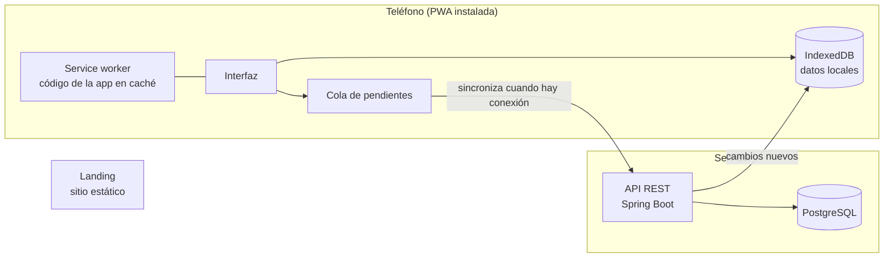

# 03 Arquitectura

Este documento describe cómo se construye la aplicación. Las decisiones tomadas tienen su registro en [decisiones](decisiones/README.md). Lo que está marcado como **propuesta** todavía no está acordado.

## Requisitos que mandan sobre el diseño

1. Los flujos esenciales funcionan sin conexión, y en un gimnasio sin señal se puede planificar, entrenar y anotar.
2. Los datos viven en el teléfono, y el servidor es la copia de respaldo y el punto de encuentro entre dispositivos.
3. Se puede instalar sin pasar por una tienda y se actualiza sola.
4. Los datos de salud son sensibles y se tratan con cuidado desde el diseño.
5. Se usa con una mano y entre series, así que la interfaz es rápida, grande y tolerante a errores.

## Visión general

## Decisión 1, plataforma

La aplicación es una PWA con enfoque offline-first. Está registrada en [ADR-001](decisiones/ADR-001-plataforma-pwa-offline-first.md).

## Cliente

Acordado en [ADR-003](decisiones/ADR-003-stack-del-cliente.md).

- **Interfaz.** React con TypeScript y Vite, que es el stack con el que el autor ya trabaja y con el que un agente de IA rinde mejor.
- **Instalación y caché.** Un service worker generado con Workbox, a través del plugin de PWA de Vite.
- **Datos locales.** IndexedDB, con una capa liviana como Dexie para trabajar con ella.
- **Estilos.** CSS propio con variables, con tema claro y oscuro, de modo que sea cómodo de leer en un gimnasio.
- **Cronómetros.** Se calculan a partir de la hora de finalización y no contando segundos, porque los navegadores frenan los temporizadores con la pantalla bloqueada. Se pide mantener la pantalla encendida durante la sesión.

## Servidor (propuesta)

- **API REST con Spring Boot y PostgreSQL**, organizada como un monolito modular, con capas claras y DTOs, igual que los otros proyectos del autor.
- **Migraciones de base de datos versionadas** con una herramienta como Flyway, para que el esquema evolucione sin romper nada.
- **Autenticación.** La aplicación se usa sin cuenta. Una cuenta es opcional y sirve solo para conectar los datos del teléfono con el servidor ([ADR-004](decisiones/ADR-004-uso-sin-cuenta.md)). El método para crearla y abrirla sigue pendiente (ver preguntas abiertas) y tiene que funcionar bien con una app que trabaja sin conexión.
- **Errores** en formato estándar `ProblemDetail`.

## Sincronización

El cliente trabaja siempre contra sus datos locales. Cada cambio se guarda localmente y queda en una cola de pendientes. Cuando hay conexión, se envía al servidor y se traen los cambios nuevos.

Reglas de diseño.

- **Identificadores generados en el dispositivo,** para crear registros sin conexión sin chocar con el servidor.
- **El envío es idempotente.** Si el teléfono reenvía algo, el servidor no lo registra dos veces.
- **Cada registro lleva una marca de versión,** y la descarga de cambios pide solo lo posterior a la última sincronización.
- **Borrado lógico,** para poder propagar un borrado a otros dispositivos.
- **Resolución de conflictos.** Para el plan, gana la última modificación por registro. Para las series realizadas, que solo se agregan, no hay conflicto posible.
- **Cuándo se sincroniza.** Al abrir la app, al volver la conexión y al terminar una sesión. Safari no soporta la sincronización automática en segundo plano, así que no se puede depender de ella.

## Actualizaciones de la aplicación

- Se publica una versión nueva en el servidor y los usuarios la reciben sin pasar por ninguna tienda.
- La app descarga la versión nueva en segundo plano y muestra un aviso para activarla.
- **Los datos locales tienen versión.** Cuando cambia la forma de guardarlos, la app migra lo que ya está en el teléfono sin perderlo.
- **La API es compatible hacia atrás durante un tiempo,** porque durante unos días puede haber teléfonos con una versión anterior hablando con un servidor más nuevo.

## Seguridad y privacidad

- Los datos de salud son datos personales sensibles. Se aplica el principio de recolectar solo lo necesario.
- La comunicación va siempre cifrada (HTTPS), y, si se usan contraseñas, se guardan con hash.
- La persona puede exportar todos sus datos y borrar su cuenta.
- Como la normativa depende del país de cada usuario (en Argentina, la Ley 25.326), hace falta una política de privacidad y un consentimiento claro antes de abrir la app al público.
- El almacenamiento del navegador puede ser borrado, sobre todo en iPhone. Por eso el servidor guarda un respaldo y la app ofrece una exportación.

## Calidad

Se aplican buenas prácticas desde el primer día, aunque el autor todavía no domine todas.

- **Pruebas automáticas.** Unitarias y de integración en el servidor, pruebas de componentes y de extremo a extremo en el cliente.
- **Integración continua** que corre las pruebas en cada cambio.
- **Revisión del código** antes de integrar cualquier cambio.
- **Accesibilidad y rendimiento** medidos con las herramientas de PWA del navegador.
- **Decisiones registradas** en esta carpeta, y documentación al día.

## Despliegue

- El cliente y la landing se publican como sitio estático con HTTPS, que es requisito de una PWA.
- El servidor se despliega como un contenedor, con la base de datos en un servicio gestionado.
- Con una app que funciona sin conexión, el arranque lento de un servidor gratuito deja de ser un problema para el usuario, porque no tiene que esperar para usarla.

## Organización del repositorio

Un único repositorio, con la documentación (`docs`), el cliente (`web`) y, cuando llegue el momento, el servidor en carpetas separadas. Es más simple para trabajar con un agente, porque el documento de diseño y el código quedan juntos y se pueden cambiar en un solo paso. Está registrado en [ADR-007](decisiones/ADR-007-repositorio-y-publicacion.md).

## Decisiones pendientes

Las preguntas que todavía no tienen respuesta están en [06 Preguntas abiertas](06-preguntas-abiertas.md).
