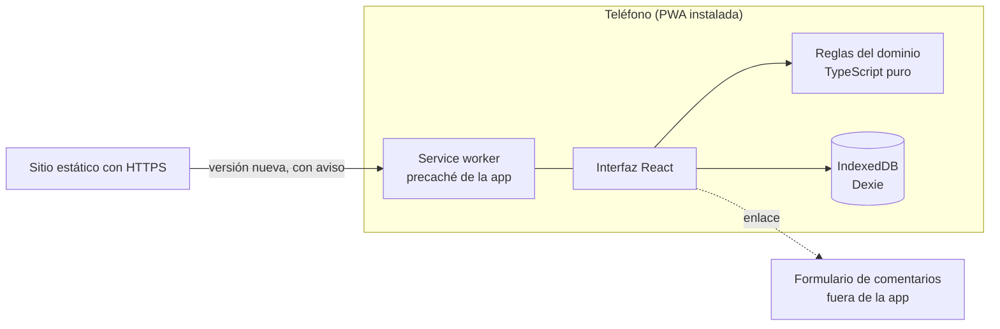

# 03 Arquitectura

Este documento describe cómo está construida la aplicación hoy. Las decisiones tienen su registro en [decisiones](decisiones/README.md). Lo que todavía no existe, como una cuenta o la sincronización, está en [05 Posibles mejoras](05-posibles-mejoras.md).

## Requisitos que mandan sobre el diseño

1. Los flujos esenciales funcionan sin conexión. En un gimnasio sin señal se puede planificar, entrenar y anotar.
2. Los datos viven en el teléfono y no hay servidor del que se dependa.
3. Se instala sin pasar por una tienda y se actualiza con un aviso.
4. Los datos de salud son sensibles. La app no recolecta ninguno ni los envía a ningún lado.
5. Se usa con una mano y entre series, así que la interfaz es rápida, grande y tolerante a errores.

## Visión general

La app es una PWA con enfoque offline-first ([ADR-001](decisiones/ADR-001-plataforma-pwa-offline-first.md)). Una vez instalada, todo el código y las imágenes están en el teléfono. La conexión solo sirve para bajar una versión nueva.

## Cliente

Acordado en [ADR-003](decisiones/ADR-003-stack-del-cliente.md).

| Pieza | Tecnología |
|---|---|
| Interfaz | React 19, TypeScript y Vite 7, con react-router |
| Instalación y caché | vite-plugin-pwa, con actualización que pide confirmación |
| Datos locales | IndexedDB a través de Dexie, con migraciones entre versiones |
| Estilos | CSS propio con variables, tema claro y oscuro, tipografía Figtree |
| Sonido | WebAudio, con tonos generados en el momento, sin archivos de audio |

### Organización del código

El código del cliente está en `web/src`.

| Carpeta | Contenido |
|---|---|
| `domain` | Las reglas del entrenamiento como funciones puras, sin pantallas ni base de datos. Es lo que más pruebas tiene |
| `db` | La base local, las consultas, la copia de seguridad y el compartir rutinas |
| `app` | La estructura de la aplicación, preferencias, sonido, instalación, paseo, copias y almacenamiento |
| `features` | Las pantallas, separadas por módulo (entrenamiento, inicio y ajustes) |
| `ui` y `brand` | Los componentes comunes, el logo y la pantalla de carga |

Separar las reglas de las pantallas permite probarlas sin abrir un navegador y cambiar la interfaz sin tocar cómo se calcula una comparación o un descanso.

## Decisiones técnicas que conviene conocer

- **Los cronómetros se calculan con la hora de fin** y no contando segundos, porque los navegadores frenan los temporizadores con la pantalla bloqueada. La app pide mantener la pantalla encendida durante la sesión.
- **El plan se copia dentro de la sesión.** Editar una rutina no cambia lo que ya se hizo.
- **Una sola sesión activa.** Simplifica el estado y evita datos cruzados.
- **Los datos tienen versión.** La base pasó de las series sueltas a los cuatro niveles con una migración que conserva lo que ya estaba cargado.
- **Almacenamiento protegido.** La app le pide al navegador no borrar sus datos y avisa en Ajustes si lo concedió. De todos modos recuerda guardar una copia cada dos semanas ([ADR-015](decisiones/ADR-015-beta-datos-copias-y-correcciones.md)).
- **Herramientas de desarrollo fuera de la versión publicada.** El modo de prueba solo existe al desarrollar o con una compilación hecha a propósito ([ADR-017](decisiones/ADR-017-herramientas-de-desarrollo.md)).
- **Aviso de actualización.** La versión nueva se descarga en segundo plano y se activa cuando la persona lo decide.

## Calidad

Se aplican buenas prácticas desde el primer día.

- **Pruebas automáticas** con Vitest y Testing Library. Cubren las reglas del dominio, la base de datos con sus migraciones, la copia y el compartir, las pantallas principales y el paseo. Hoy son 74.
- **Tipos estrictos** con TypeScript y revisión de estilo con ESLint y Prettier.
- **Integración continua** en GitHub Actions. En cada cambio corre el lint, la verificación de tipos, las pruebas y la compilación.
- **Decisiones registradas** en esta carpeta, y documentación al día.

## Seguridad y privacidad

- La app **no recolecta datos** y no tiene cuentas, anuncios ni analítica. Todo queda en el teléfono.
- El formulario de comentarios es un enlace externo. No se envía nada de lo que la persona guardó.
- La comunicación va siempre cifrada, porque una PWA lo exige.
- La persona puede exportar sus datos y borrarlos.
- El almacenamiento del navegador puede ser borrado por el sistema, sobre todo en iPhone. Por eso la app ofrece la copia de seguridad y la recuerda.
- La app no da indicaciones médicas. Recomienda consultar con un médico antes de empezar un plan ([ADR-016](decisiones/ADR-016-paseo-y-recomendaciones.md)).

## Publicación

La aplicación se publica como un sitio estático con HTTPS. Cada cambio pasa por la integración continua y se despliega solo. Cada dirección es un origen distinto para el navegador, así que cambiar de dirección implica guardar una copia en la anterior y restaurarla en la nueva. Los detalles están en [ADR-007](decisiones/ADR-007-repositorio-y-publicacion.md).

## Si la app crece

Estas piezas no existen hoy y se describen en las posibles mejoras: una cuenta opcional para sincronizar entre teléfonos ([ADR-004](decisiones/ADR-004-uso-sin-cuenta.md)), un servidor para el respaldo, y los módulos de alimentación y pasos.

## Decisiones pendientes

Las preguntas que todavía no tienen respuesta están en [06 Preguntas abiertas](06-preguntas-abiertas.md).
