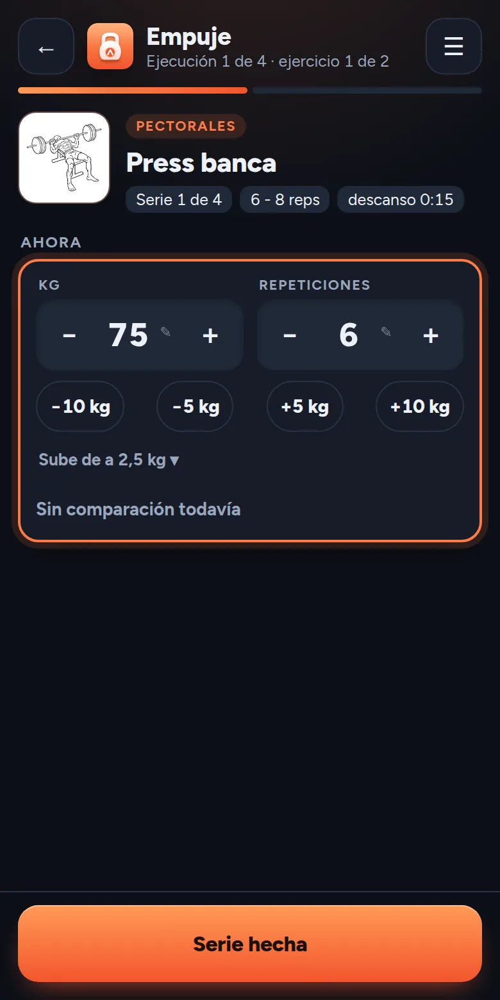
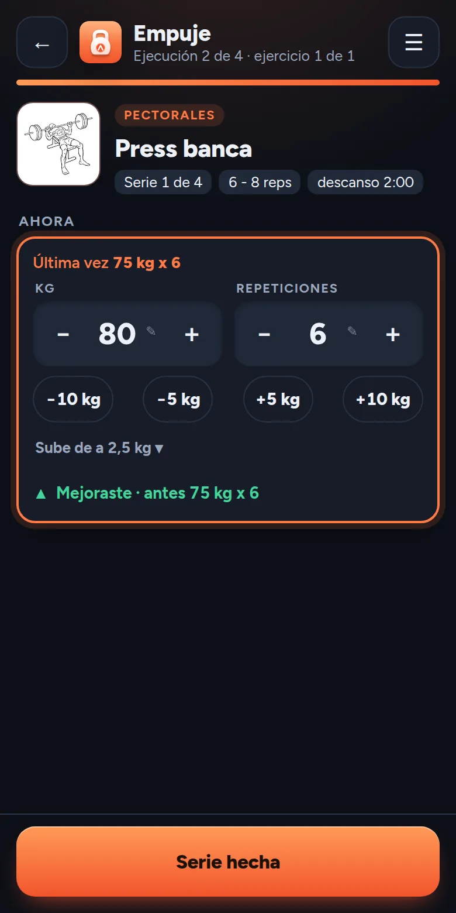
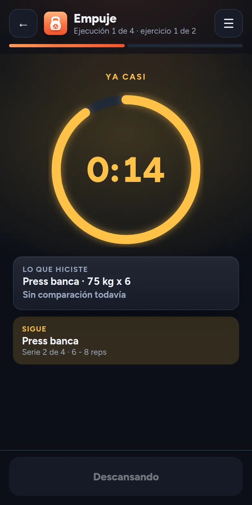
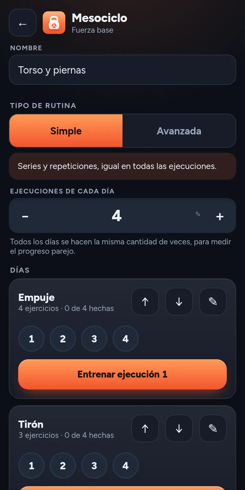
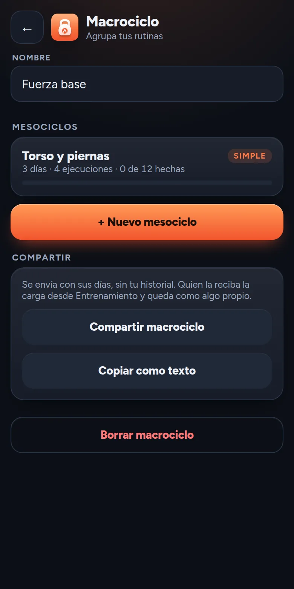
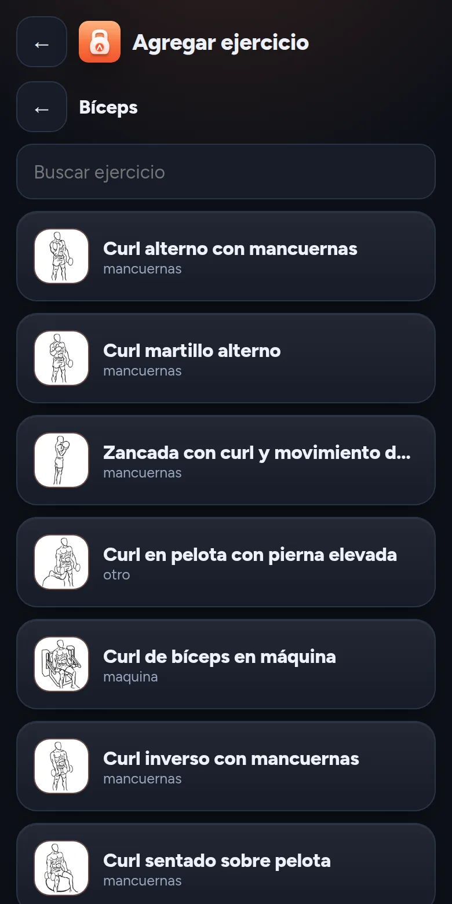

# 07 Diseño visual

Cómo se ve y cómo se usa la aplicación en el gimnasio. La historia de cómo se llegó a esta estética está en [historia](historia.md).

## Principios para usarla entrenando

- **Una mano y el pulgar.** Lo que se toca durante la serie está en la parte de abajo de la pantalla. El botón principal ocupa todo el ancho, y los controles de peso y repeticiones son grandes.
- **Una cosa por pantalla.** Durante una serie se ve un solo ejercicio, con lo que se hizo la vez anterior a la vista.
- **Se lee de lejos y con las manos transpiradas.** Los números principales son grandes y en negrita, con cifras de ancho fijo para que no salten.
- **El color nunca está solo.** Mejoró (▲), igual (=) y por debajo (▼) llevan símbolo y texto además de color.
- **Pocas pantallas,** y todas alcanzables con un toque desde la sesión en curso.

## Temas

La aplicación tiene tema oscuro y tema claro, y por defecto sigue el del teléfono, con una opción para cambiarlo a mano. El tema claro no usa blanco puro, el fondo es un gris suave. El oscuro tampoco usa negro puro, para que el contraste no canse. En los dos casos el color principal cambia de tono para mantener buena legibilidad.

## Color y tipografía

La estética está en [ADR-009](decisiones/ADR-009-estetica-y-tipografia.md). Cada módulo tiene su color, EntrenAndo naranja, AlimentAndo verde y CaminAndo azul. La suite tiene el suyo, el violeta, que es el de "Ando" en el nombre. La tipografía es Figtree, con cifras de ancho fijo. Las tarjetas y los botones llevan un relieve suave y un degradé.

## Logo y pantalla de carga

El logo es un círculo de tres sectores que comparten sus bordes, uno por módulo. Lleva una kettlebell sobre naranja, un bowl de ensalada con un tenedor sobre verde y unas huellas sobre azul ([ADR-008](decisiones/ADR-008-mejorando-nombre-y-logo.md)). Cada módulo usa su sector como ícono propio. El ícono de instalación llena todo el cuadrado con los tres sectores, para que el sistema lo recorte como un círculo.

La pantalla de carga muestra seis huellas que aparecen una a una, con los colores del degradé de la marca, hasta llegar al nombre ([ADR-006](decisiones/ADR-006-logo-y-pantalla-de-carga.md)). Dura cuatro segundos, respeta la preferencia de reducir el movimiento y se puede saltar con un toque. Los archivos están en [diseno/logo](diseno/logo).

## Pantallas

| | | |
|---|---|---|
|  |  |  |
| **Serie.** El ejercicio con su dibujo, lo que pide el plan, peso y repeticiones con atajos | **Comparación.** La última vez, y si se mejoró, con símbolo y texto | **Descanso.** Cronómetro circular que cambia de color al final |
|  |  |  |
| **Mesociclo.** Los días con sus ejecuciones | **Compartir.** Pasar una rutina a otra persona | **Catálogo.** Los ejercicios por grupo, con su dibujo |

- **Serie.** El ejercicio con su músculo, el objetivo del plan, la última vez, selectores de peso y repeticiones, y el botón de "Serie hecha".
- **Descanso.** El tiempo se calcula con la hora de fin, así sigue bien si la pantalla se bloquea. Muestra lo que se acaba de hacer comparado con la vez anterior, y lo que sigue.
- **JumpSet.** Se ve el paso actual de la ronda, con el descanso que sigue entre un ejercicio y el otro.
- **Lista del entrenamiento.** Todos los ejercicios del día, con lo hecho y lo que sigue.
- **Resumen.** Las series de una sesión terminada, que se pueden corregir o borrar.

## Accesibilidad

- Contraste suficiente entre texto y fondo en los dos temas.
- Objetivos táctiles grandes.
- El estado de una serie nunca depende solo del color.
- La pantalla se mantiene encendida durante la sesión.
- Se respeta la preferencia de reducir el movimiento.
